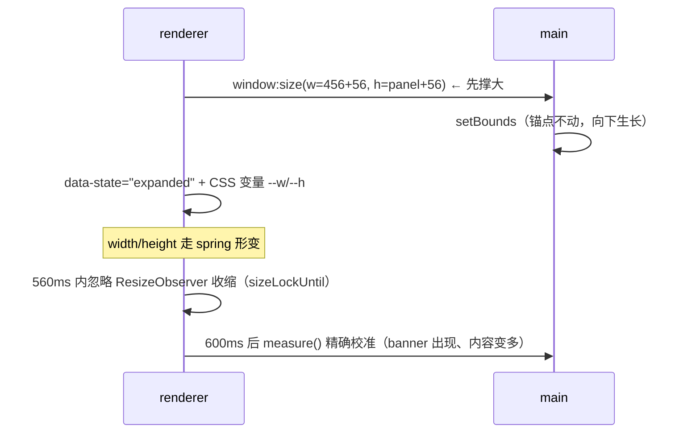

# 架构说明

## 1. 进程模型

```
┌─────────────────────────── Electron main ───────────────────────────┐
│  main.js        启动、IPC 注册、按路径分发配置变更、诊断、托盘         │
│  window.js      IslandWindow：锚点定位 / 主进程拖动 / 光标推送        │
│  dev-harness.js 截图回归夹具（只在 --dev 下加载）                     │
│  platform/      win32（SMTC / 媒体键 / 蓝牙 / 进程 / 鼠标左键）        │
│  services/      media · ai · bluetooth · stash · clock · health      │
│                 · notify · todo · sysinfo · devices · fullscreen      │
│                 · config                                             │
└───────────────┬──────────────────────────────────────────────────────┘
                │ contextBridge（preload.js，contextIsolation: true）
┌───────────────▼──────────────────────────────────────────────────────┐
│ renderer（无 node 权限）                                              │
│  app.js    状态机 / dock / 拖放 / 眼睛 / banner / 尺寸回报            │
│  panels/*  十个面板，只通过 ctx 与外界交互                            │
└──────────────────────────────────────────────────────────────────────┘
```

渲染层拿不到 `fs`、`require`、`process`。所有系统能力都过一层 IPC，参数在主进程里校验（例如
`app:openExternal` 只放行 `http(s)`）。只有 Windows 实现：`platform/index.js` 在非 win32 上
直接抛错，`main.js` 会在 `app.whenReady()` 前退出。

## 2. 位置模型：一个锚点，一个主人

这是 0.3.0 最重要的一次重构，也是「拖动时疯狂闪烁」的根因修复。

```
general.anchor = { x, y }        // 岛顶部中心的 DIP 屏幕坐标，null = 顶部居中
        ↓
boundsFor(anchor, { w, h })      // 唯一一处把「逻辑尺寸」翻译成屏幕矩形
        ↓
win.setBounds(...)               // 任何尺寸变化都只走这条路
```

旧模型同时存 `position` 与 `offsetX/offsetY`，`applyPosition()` 按配置重算、`setContentSize()`
按当前 bounds 重算——两个主人在同一帧里各写一次 `setBounds`，加上 `config.patch()` 恒定 emit
`['*']` 把 `applyPosition()` 拉进每一次配置事件，就表现为持续抖动。

现在：

- 尺寸变化只改 `--w/--h`，然后由 `measure()` 走 `window:size`，主进程用**当前锚点**反算矩形；
- 拖动只改锚点，不碰尺寸；
- 配置变更是 `diffPaths()` 出来的真实路径，主进程按前缀 `touched(keys, 'general.anchor')` 分发；
- 拖动进行中，`applyPosition()` 直接 return，避免和拖动写同一块几何。

## 3. 拖动：主进程轮询，而不是 `-webkit-app-region: drag`

`app-region: drag` 会把区域内的点击一并吞掉，胶囊就不可点了——而胶囊必须可点（点开面板）。

```
pointerdown（胶囊 / 面板标题栏，排除按钮与输入框）
  → 位移 > 5px 才认定是拖动（否则交给 click）
  → invoke('window:dragStart')            // 记 anchor0 与 cursor0
main: setInterval 16ms
  → cursor = screen.getCursorScreenPoint()
  → setBounds(boundsFor(anchor0 + (cursor - cursor0)))
  → 每 6 帧 askBridge 一次 mouse.left（GetAsyncKeyState(0x01)）
  → 左键已松开 → endDrag()
endDrag → 落盘 general.anchor + send('wl:dragEnd', { moved })
```

为什么不用渲染层的 `pointermove`：快速甩动时 `pointerup` 会丢在窗口外面，渲染层再也收不到事件，
岛就粘在鼠标上了。主进程查真实按键状态是唯一可靠的办法。`[data-dragging="1"]` 期间关掉所有
过渡动画，否则 16 ms 一次的 `setBounds` 会和 CSS 过渡打架。

## 4. 窗口尺寸协商（「没有透明框」的核心）

Chromium 的透明窗口**不会**让透明像素变成鼠标穿透：窗口矩形内所有坐标都会命中窗口。所以
「一个铺满屏幕的透明窗口 + 中间画个小岛」必然在桌面上留一块看不见的死区。

wl-Island 让窗口**始终等于内容**：

```
#stage = padding 28px + 岛本体（+ banner 栈）
         ↓ ResizeObserver（rAF 合并）
invoke('window:size', { w: stage.offsetWidth, h: stage.offsetHeight })
         ↓
main: setBounds(boundsFor(anchor, { w, h }))
```

28px 的 padding 是给 `box-shadow` 留的绘制空间——阴影超出窗口会被裁掉。

**展开时的时序**（避免裁切）：



收起时反过来：先跑动画，`ResizeObserver` 随动画逐步收缩窗口，460ms 后销毁面板。

窗口参数：`frame:false, transparent, hasShadow:false, thickFrame:false, skipTaskbar:true`，
`showInactive()` 起窗口，永不抢焦点。

## 5. 光标推送（眼睛）

收缩态的窗口只有 204×92 DIP，光标绝大多数时间在窗口之外，渲染层根本收不到 `pointermove`。

- 主进程 80 ms 读一次 `screen.getCursorScreenPoint()`，减去窗口中心，按 380 / 300 归一化后
  clamp 到 ±1，保留两位小数；**只有变化时才发** `wl:cursor {dx, dy}`；
- 渲染层在岛内再用 `pointermove` 做一次更精细的本地覆盖（窗口内精度更高）；
- 眨眼由渲染层自己排期（2.6–7.8 s 随机，20% 连眨两下），不需要主进程参与；
- 收到通知时 `glance(0, -0.6)` 让瞳孔先「惊」一下再归位。

只在 `state === 'collapsed'` 时应用，展开态眼睛被 `.pill` 一起淡出。

## 6. 状态机

```
             click / tray
  collapsed ───────────────▶ expanded(panel)
      ▲                          │
      │  Esc / ⌄ / 光标移开 / 超时 │
      └──────────────────────────┘
```

收起有两条路径，优先级完全不同：

| 触发 | 延迟 | 条件 |
| --- | --- | --- |
| **光标移开**（主路径） | `general.leaveDelay`，默认 0.4 s | `collapseOnLeave` 开启 |
| 无操作超时（兜底） | `general.autoCollapseDelay`，默认 8 s | 没有光标参与时（键盘唤起、托盘） |

两条都先过 `busy()`：光标还在岛上、正在拖动、或焦点在 `INPUT/TEXTAREA/SELECT` 里时不收，
并把自己重新排期——正在填 API Key 时被抽走面板是很烦的。

光标状态用引用计数：`#island` 与 `#banners` 各自 `pointerenter` 加一、`pointerleave` 减一，
归零才算离开。banner 是 island 的兄弟节点，鼠标移过去读通知时不会收起。

- `S.panel` 记住上次打开的面板；每个面板声明自己的 `height` 作为**设计尺寸**，展开宽度固定 456。
- 声明高度是「地板」不是天花板：`fitPanel()` 实测 `header + view.scrollHeight + dock`，超了就长高
  （上限 600），绝不允许裁掉内容。测量只在几何稳定后进行（`|box - --h| <= 1.5`），否则形变中途的
  拉伸尺寸会被误当成内容高度，越撑越大。
- 面板内容变了（切 tab、刷新列表）由 `#view` 上的 `MutationObserver`（rAF 合并）触发重新拟合。
- banner 是 `#island` 之外的兄弟节点，通知不会打断当前面板。

### 收缩态的三种形态

| 形态 | 宽度 | 内容 |
| --- | --- | --- |
| idle | 148 | 一双眼睛 + 时钟 |
| media | 248 | 眼睛 + 标题/歌手 + 波形 + 时钟 |
| lyric | 340 | 眼睛 + 当前歌词 + 波形 + 时钟 |

状态由 `#island[data-idle="1"]` / `[data-lyric="1"]` 控制，宽度由 `BOX` 表驱动
（`syncPillWidth()`），实际窗口尺寸随后由 `measure()` 回报。

歌词当前行靠本地插值算，不依赖每次轮询：`pos = position + (playing ? (now - stamp)/1000 : 0)`，
再用 220 ms 的 timer 推进，换行误差不超过一帧。间奏行是空的，此时**保留上一句**而不是清空——
否则胶囊会每隔几秒变窄一次，抖动比留一句假歌词更糟。渲染用两条绝对定位的行（`#lyA`/`#lyB`）
交替：新的从下方 115% 升到 0，旧的升到 -115%，`.slide` 负责超长行的缓慢横移。

### 拖放

`dragenter` 有文件 → `enterDrop()`：打 `data-drop="1"`、按需 `open('files')`、切到中转站面板。
`dragover` 只更新「n 个项目」计数并续命（900 ms 没有 `dragover` 就自行退出投放态——`dragleave`
在某些应用里不会触发）。`drop` 取 `webUtils.getPathForFile()` 的路径交给 `stash:add` 复制。

投放态的视觉是三层：`::after` 换成一圈 accent 光晕、`.drop-veil` 铺一层玻璃、虚线环呼吸。
展开时 `.panel` 整体 `opacity: 0`——否则卡片底下压着半屏文字，看起来像两个图层在抢注意力。

## 7. 主题

主题不是一张壁纸，是一整套 token 覆盖：

```css
:root[data-theme="ocean"] {
  --bg-a / --bg-b        玻璃两层底色
  --accent / --accent-2  强调色与副强调
  --accent-soft/-line    光晕与描边
  --surface-1 / -2       面板表面
  --hair / --hair-2      分割线
  --text / -2 / -3       文字三级
  --eye-iris / --eye-hi  瞳孔与高光
}
```

`appearance.theme` 变化时主进程发 `wl:appearance`，渲染层只改 `<html data-theme>`，不需要重绘
任何组件。「雪原」是唯一一套浅色主题，它把上述 token 全部反转，因此所有面板、输入框、滑块、
代码块都会真的反色，不会出现白底白字。

设置页里的六张预览卡直接在卡片内联 `--sa/--sb/--sc/--sd/--se`，用自己的配色渲染自己的缩略图。

## 8. IPC 协议

统一信封：`{ ok: true, data }` / `{ ok: false, error }`，渲染层在 `bridge.js` 里解包并抛错。
通道前缀 `wl:`。

| 通道 | 入参 | 说明 |
| --- | --- | --- |
| `app:info` / `app:diagnose` | — | 版本、适配器、逐项体检 |
| `config:get` / `config:patch` / `config:reset` | 部分配置 / — | 深合并，原子写盘，只 emit 真实变更路径 |
| `window:size` | `{w,h}` | stage 尺寸（CSS px），主进程用锚点反算矩形 |
| `window:dragStart` / `dragEnd` | — | 开始 / 结束主进程拖动 |
| `window:preset` / `resetPos` | `{where}` | 五个快速停靠点 / 回到顶部居中 |
| `media:state` / `media:art` / `media:sessions` / `media:control` / `media:target` | — | 播放状态、封面、会话列表、控制、固定播放器 |
| `ai:chat` / `ai:stop` / `ai:balance` / `ai:reset` | `{text}` | 流式对话、上下文 / 余额 |
| `ai:models` / `ai:presets` | — | 服务商预设与 `/models` 列表 |
| `bt:list` | — | 蓝牙设备（含类型推断） |
| `clock:*` | — | 闹钟 CRUD + 计时器 |
| `stash:*` | — | 中转站（含 `startDrag` 原生拖出） |
| `todo:list` / `add` / `update` / `remove` / `clearDone` | — | 待办 |
| `notify:list` / `notify:test` / `notify:action` | — | 通知历史与动作回调 |
| `health:status` / `health:reset` | `{kind}` | 久坐 / 喝水 |
| `sys:info` / `sys:action` / `sys:revealStash` / `sys:copyText` / `sys:battery` | — | 状态面板、静音/截图/锁屏/任务管理器、小工具 |
| `sys:devices` / `sys:storage` | `{refresh}` | USB / 串口枚举、C: 与临时 / 休眠文件 |
| `sys:cleanTemp` / `sys:hibernate` | `{days}` / `{on}` | 原生确认框 → 清理 `%TEMP%` / `powercfg /h` |

主进程 → 渲染层的推送：`media`、`media:art`、`bt`、`note`、`config`、`cursor`、`dragEnd`、
`ai:chunk`、`ai:done`、`ui:action`、`ui:appearance`。

## 9. 服务生命周期

| 服务 | 轮询 / 触发 | 备注 |
| --- | --- | --- |
| `MediaService` | 1.6s（可配） | 只在状态变化时 emit；活跃时本地插值 |
| `BluetoothService` | 10s | 用签名字符串去抖，避免 UI 闪烁 |
| `ClockService` | 10s tick | 按 `(日期, 分钟, alarmId)` 去重，休眠唤醒不会重复响 |
| `HealthService` | 30s | `powerMonitor.getSystemIdleTime() >= 90s` 视为已起身 |
| `NotifyService` | 事件驱动 | 内部队列 + `127.0.0.1:7788` HTTP |
| `SysInfoService` | 1.1s 缓存 | CPU 用 `os.cpus()` 差值；内存占用前 5 走 `proc.top`（4s 缓存）；`sys.storage` 按需调用 |
| `DeviceService` | 5s 缓存 | `dev.usb` / `dev.com`，切页不重复枚举 |
| `FullscreenService` | 2s | `fg.fullscreen`：前台窗口矩形 ≥ 所在显示器且不在原点外 → 隐藏岛 |
| `TodoService` | 事件驱动 | 独立 `todos.json` |

配置变化只会 `restart()` 相关服务：`touched(keys, 'media')` 命中才重启媒体轮询，
`touched(keys, 'general.anchor')` 只重算位置，改 `appearance` 连服务都不碰。

## 10. 数据落地

- 配置：`<userData>/wl-island.config.json`（原子写：写 `.tmp` 再 rename）
- 待办：`<userData>/todos.json`（勾选 / 星标不该被当成一次设置变更）
- 中转站：`<userData>/stash/<id>__<原文件名>`
- 封面 / 歌词：内存 LRU（12 / 10 条），不落盘
- 没有任何遥测，没有账号体系

## 11. 加一个面板要改什么

1. 新建 `desktop/renderer/js/panels/xxx.js`，导出 `{ id, label, icon, height, sub(S), mount(view, ctx) }`
2. `mount` 返回 `{ update, destroy }`，在 `destroy` 里清定时器和 `ctx.on()` 返回的退订函数
3. 在 `app.js` 的 `PANELS` 数组里加一行（dock 顺序即数组顺序，dock 的
   `grid-template-columns` 也要跟着改成 `repeat(n, 1fr)`）
4. 需要新系统能力时，在 `main.js` 的 `registerIpc` 里加 `handle('xxx:yyy', ...)`，并在上面的协议表里补一行

面板不要用 `invoke` 之外的方式碰主进程，也不要自己去读 `window.wl`。
